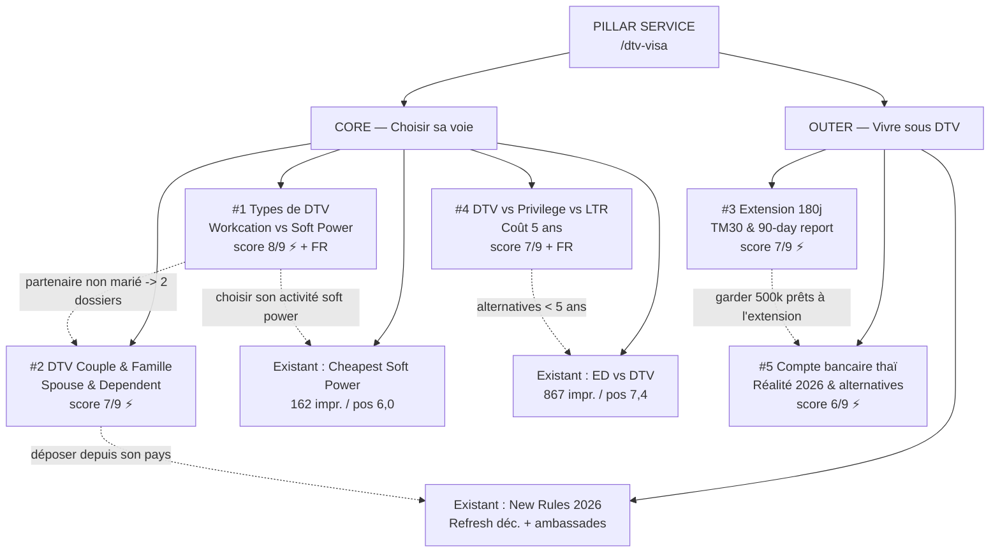

# Topical Map : DTV Visa Thailand — Types, comparatifs longue durée & vie sur place (Vague 2)

> Généré le 2026-11-24. Expansion en mode `deepen` du silo service existant `/dtv-visa`.
> **Périmètre retenu** : **5 nouveaux articles EN + 2 transcréations FR** (plus **1 refresh ciblé** sur un article existant). **10 articles EN + 3 FR** déjà publiés conservés sans chevauchement.
> Marché : nomades, freelances, couples/familles et pratiquants Muay Thai longue durée (EN-first, FR sélectif).
> Sources : `.seo-data/gsc-wildcat-2026-11-21.json`, `.seo-data/keywords-dtv-*.json`, `.seo-data/gatekeeper-dtv-expansion.json`, `docs/topical-map-dtv-costs.md`, `docs/seo/content-map.md`, `docs/dtv-fact-check.md`, `docs/brand/proofs.md`.
>
> *Note data : clé DataForSEO absente dans cette session ; les volumes cités viennent des fichiers `.seo-data/` existants et des performances Search Console réelles au 21/11/2026 (aucun volume inventé).*

---

## 0. Doctrine Google AI Search appliquée à cette série

Tiré du guide officiel Google (*Optimizing your website for generative AI features on Google Search*, `developers.google.com/search/docs/fundamentals/ai-optimization-guide`) :

1. **AI Overviews et AI Mode reposent sur le RAG (grounding) depuis l'index Search classique.** Sans indexation propre ni pertinence organique classique, un article ne peut pas être cité. Priorité à des URLs ciblées, maillées et sans dilution plutôt qu'au volume brut (rappel : cadence disciplinée car l'indexation est le goulet du site).
2. **Contenu non-commoditisable et expérience de première main (E-E-A-T).** Ce qui se fait citer par l'IA, c'est ce qu'un résumé générique ne peut pas inventer : pièges réels de rejet (portfolios freelances, partenaires non mariés), réalités terrain à Chiang Mai (immigration, TM30, refus bancaires 2026), tableaux chiffrés sourcés.
3. **Zéro gadget « AI-only ».** Pas de sur-découpage artificiel ni de balisage hors standard : HTML sémantique propre, tableaux comparatifs lisibles, JSON-LD `BlogPosting` aligné sur le contenu visible et auteur `Person` `#meaw`.
4. **Discipline YMYL.** Ne jamais s'étendre hors de la légitimité prouvée de Wildcat (`docs/brand/proofs.md`) : c'est pourquoi un guide fiscal dédié est écarté (`FAIL grounding` dans le Gatekeeper).

---

## 1. Fondation (Koray)

- **Source Context** : Camp de Muay Thai familial et open-air à Chiang Mai tenu par Meaw, qui accompagne en direct des élèves longue durée sur la voie Soft Power du DTV (100+ dossiers approuvés) et monétise les forfaits d'entraînement / Stay & Train.
- **Central Entity** : Destination Thailand Visa (DTV) pour vivre et s'entraîner en Thaïlande.
- **Central Search Intent** : Choisir la bonne voie DTV (ou la bonne alternative longue durée), éviter les motifs de refus et gérer sereinement son séjour une fois en Thaïlande — avec le Muay Thai Soft Power chez Wildcat comme option concrète et transparente.

---

## 2. Inventaire existant (zone protégée — zéro duplication)

| Couche | URLs déjà live (sans préfixe locale) | Ce qui est déjà traité (interdit de recréer) |
|---|---|---|
| **Pages service (4)** | `/dtv-visa`, `/dtv-visa/eligibility`, `/dtv-visa/how-to-apply`, `/dtv-visa/long-stay-training` | Définition globale DTV, éligibilité/quiz 6 Q, process 7 étapes, checklist, budget mensuel vie+training, FAQ 30 Q (`#faq`), comparatif DTV/ED/TR (`#compare`). |
| **Sous-cluster Prix (7 EN + 1 FR)** | `/blog/dtv-visa-cost-breakdown` (+ FR `visa-dtv-thailande-prix`), `muay-thai-gym-dtv-overcharging`, `cheapest-dtv-soft-power-activity`, `dtv-visa-agent-worth-it`, `dtv-visa-proof-of-funds`, `dtv-visa-refund-if-rejected`, `dtv-vs-tourist-visa-runs-cost` | **100 % du sujet prix/coûts** : frais d'ambassade, coût des cours Soft Power (Muay Thai vs cuisine vs langue), surfacturation gyms, agent oui/non, actifs 500k, remboursement en cas de refus, DTV vs border runs touristiques. |
| **Autres visa (3 EN + 2 FR)** | `/blog/ed-visa-vs-dtv-muay-thai` (+ FR `visa-etudiant-thailande-ed-ou-dtv`), `/blog/thailand-visa-guide-by-training-length` (+ FR `visa-thailande-guide-duree-de-sejour`), `/blog/dtv-visa-new-requirements-2026` | ED vs DTV (**n°1 GSC : 867 impr., 23 clics, pos. 7,4**), choix du visa par durée de séjour, nouvelles règles 2026 (dépôt pays de résidence + casier judiciaire). |

**Conséquence directe** : aucun nouvel article « prix du DTV » n'est créé. La vague 2 comble exclusivement les **types de DTV**, les **comparatifs longue durée 5–20 ans** et la **vie pratique après obtention**.

---

## 3. Hiérarchie thématique

### Pillar racine (existant, aucune nouvelle page pillar) : Muay Thai Visa & DTV Thailand — `/dtv-visa`
Keyword : `dtv visa thailand` (1 600/mo) | Intent : informationnel / service | Statut : **Existant**

#### Cluster A : Types de DTV & choix de la bonne voie — **Core**
- `dtv-visa-types-workcation-vs-soft-power` — Les 3 types de DTV : Workcation vs Soft Power vs Dependent **À créer** ⚡ (+ FR)
- `dtv-visa-spouse-dependent` — DTV en couple ou en famille : conjoint, enfants et piège des couples non mariés **À créer** ⚡
- `dtv-vs-ltr-elite-retirement-visa` — DTV vs Thailand Privilege (Elite) vs LTR : coûts sur 5 ans et règles **À créer** (+ FR)
- `cheapest-dtv-soft-power-activity` — Activité Soft Power la moins chère (Muay Thai vs cuisine vs langue) **Existant** (162 impr., 10 clics, pos. 6,0)
- `ed-visa-vs-dtv-muay-thai` — ED Visa vs DTV pour le Muay Thai **Existant** (867 impr., 23 clics, pos. 7,4)

#### Cluster B : Après l'obtention — vivre et rester conforme en Thaïlande — **Outer**
- `dtv-visa-180-day-extension-tm30` — Extension 180 jours sur DTV : immigration Chiang Mai vs vol A/R, TM30 et 90-day report **À créer** ⚡
- `dtv-visa-thai-bank-account` — Ouvrir un compte bancaire thaïlandais avec un DTV en 2026–2027 : réalité et alternatives **À créer** ⚡
- `dtv-visa-new-requirements-2026` — Nouvelles règles DTV (pays de résidence, casier, délais par ambassade) **Existant → Refresh déc. 2026**

---

## 4. Carte visuelle (Mermaid)

---

## 5. Couverture fan-out (4 axes)

- **Reformulation** : `dtv-visa-types-workcation-vs-soft-power` (« 3 types of DTV visa Thailand », « DTV categories explained »).
- **Décomposition** : `dtv-visa-spouse-dependent` (dépendants, mariage, enfants), `dtv-visa-180-day-extension-tm30` (extension 180 j, TM30, TM.47).
- **Comparaison** : `dtv-visa-types-workcation-vs-soft-power` (Workcation vs Soft Power), `dtv-vs-ltr-elite-retirement-visa` (DTV vs Privilege vs LTR vs Retirement).
- **Implication** : `dtv-visa-thai-bank-account` (« puis-je ouvrir un compte local ? »), `dtv-visa-180-day-extension-tm30` (« que se passe-t-il au bout de 90 et 180 jours ? » + encart compteur fiscal 180 j).
- **Trous détectés** : aucun trou non traité sur les 4 axes.

---

## 6. Tableau de production (trié par priorité)

Tous les articles ci-dessous ont passé les **2 gates** de `.seo-data/gatekeeper-dtv-expansion.json` (Surprise Gap + Grounding).

| # | Article | Sec. | Statut | Brand | Bus./Compl. | Trafic | Score | ⚡ | Module | Slug EN | Version FR |
|---|---|---|---|---|---|---|---|---|---|---|---|
| 1 | DTV Visa Types: Workcation vs Soft Power vs Dependent | Core | À créer | 3 | 3 | 2 | **8** | ⚡ | E | `dtv-visa-types-workcation-vs-soft-power` | **Oui** (`visa-dtv-thailande-types-workcation-soft-power`) |
| 2 | DTV Visa for Couples & Families (Spouse & Dependents) | Core | À créer | 3 | 2 | 2 | **7** | ⚡ | A | `dtv-visa-spouse-dependent` | Optionnel T2 |
| 3 | DTV 180-Day Extension: Immigration vs Border Run, TM30 & 90-Day Report | Outer | À créer | 2 | 3 | 2 | **7** | ⚡ | A | `dtv-visa-180-day-extension-tm30` | Optionnel T2 |
| 4 | DTV vs Thailand Privilege (Elite) vs LTR: 5-Year Cost Compared | Core | À créer | 2 | 3 | 2 | **7** | — | E | `dtv-vs-ltr-elite-retirement-visa` | **Oui** (`visa-dtv-vs-elite-ltr-thailande`) |
| 5 | Can You Open a Thai Bank Account on a DTV Visa? | Outer | À créer | 2 | 3 | 1 | **6** | ⚡ | A | `dtv-visa-thai-bank-account` | Non (EN-first) |

*Note sur la colonne Trafic : score prudent (1–2) basé sur les signaux existants `.seo-data/keywords-dtv-*.json` (ex. `dtv visa thailand soft power` 20/mo, `dtv visa thailand bank account` 10/mo, `thailand digital nomad visa` 880/mo) et les performances GSC du format comparatif (`ed-visa-vs-dtv-muay-thai` : 867 impr./28 j).*

---

## 7. Intent Layering (silo blog DTV complet : 10 existants + 5 nouveaux = 15 articles)

- **Informationnel / pratique** : **60 %** (9/15 — dont #2, #3, #5 dans cette vague).
- **Commercial / comparatif** : **40 %** (6/15 — dont #1 et #4 dans cette vague, plus `ed-visa-vs-dtv`, `cheapest-dtv-soft-power-activity`, `dtv-vs-tourist-visa-runs-cost`, `dtv-visa-agent-worth-it`).
- **Transactionnel pur** : **0 %** côté blog (volontaire : toute la transaction vit sur `/dtv-visa`, `/stay-train#plan` et `/contact?intent=dtv`).
- **Analyse** : équilibre sain pour Google Search et AI Overviews (majorité informationnelle + comparatifs qui convertissent et qui performent déjà le mieux en GSC).

---

## 8. Blueprint de maillage interne

Convention obligatoire (`docs/seo/context.md`) : **`prefix-at-build`** — écrire tous les liens **sans** `/en` ni `/fr` (`/dtv-visa`, pas `/en/dtv-visa`). Ne jamais lier les anciennes URLs supprimées (`/dtv-visa/muay-thai`, `/dtv-visa/faq`) : utiliser `/dtv-visa#compare` et `/dtv-visa#faq`. Ne poser un lien entrant vers un futur article qu'une fois celui-ci publié.

| Article | Liens sortants obligatoires | Liens sortants recommandés (Contextual Bridges) | Liens entrants attendus (à la sortie) |
|---|---|---|---|
| #1 `dtv-visa-types-workcation-vs-soft-power` | `/dtv-visa`, `/dtv-visa/eligibility` | `/blog/cheapest-dtv-soft-power-activity`, `/blog/dtv-visa-cost-breakdown`, `/blog/dtv-visa-spouse-dependent`, `/contact?intent=dtv` | `/dtv-visa`, `/blog/cheapest-dtv-soft-power-activity`, `/blog/dtv-visa-cost-breakdown` |
| #2 `dtv-visa-spouse-dependent` | `/dtv-visa`, `/dtv-visa/eligibility` | `/blog/dtv-visa-types-workcation-vs-soft-power`, `/blog/dtv-visa-proof-of-funds`, `/blog/dtv-visa-new-requirements-2026`, `/stay-train` | `/dtv-visa/eligibility` (bloc quiz Q6), `/blog/dtv-visa-types-workcation-vs-soft-power` |
| #3 `dtv-visa-180-day-extension-tm30` | `/dtv-visa`, `/dtv-visa/how-to-apply` | `/blog/dtv-visa-proof-of-funds`, `/blog/dtv-vs-tourist-visa-runs-cost`, `/blog/dtv-visa-thai-bank-account`, `/dtv-visa/long-stay-training` | `/dtv-visa#faq` (q20–q23), `/blog/dtv-vs-tourist-visa-runs-cost`, `/dtv-visa/long-stay-training` |
| #4 `dtv-vs-ltr-elite-retirement-visa` | `/dtv-visa`, `/dtv-visa#compare` | `/blog/ed-visa-vs-dtv-muay-thai`, `/blog/dtv-visa-cost-breakdown`, `/blog/thailand-visa-guide-by-training-length` | `/blog/ed-visa-vs-dtv-muay-thai`, `/blog/thailand-visa-guide-by-training-length`, `/dtv-visa` |
| #5 `dtv-visa-thai-bank-account` | `/dtv-visa`, `/dtv-visa/long-stay-training` | `/blog/dtv-visa-proof-of-funds`, `/blog/dtv-visa-180-day-extension-tm30`, `/stay-train` | `/blog/dtv-visa-proof-of-funds`, `/blog/dtv-visa-180-day-extension-tm30`, `/chiang-mai-guide` |

---

## 9. Mini-briefs — articles à créer

### 1. DTV Visa Thailand Types: Workcation vs Soft Power vs Dependent

- Slug : `dtv-visa-types-workcation-vs-soft-power` (FR : `visa-dtv-thailande-types-workcation-soft-power` · `translationKey: dtv-visa-types-workcation-vs-soft-power`)
- Slug rationale : court, descriptif, capte « DTV types » et la comparaison principale Workcation vs Soft Power sans date
- Type de page : article (spoke) — pillar racine = `/dtv-visa`
- Keyword principal : `dtv visa thailand workcation vs soft power` (secondaires : `dtv visa thailand categories`, `dtv visa thailand soft power` 20/mo, `dtv visa freelance portfolio rejected`)
- Section : Core
- Sous-requêtes fan-out couvertes : quelles sont les 3 catégories du DTV · différence Workcation vs Soft Power · pourquoi un portfolio freelance se fait rejeter · un remote worker peut-il appliquer en Soft Power Muay Thai
- Module : E (comparatif décisionnel) — tableau 3 voies (qui, preuves requises, coût extra, risque de rejet, meilleur cas d'usage) + arbre de décision par profil
- Intent : Commercial / Informationnel
- Score : 8/9 (Brand 3 · Business 3 · Trafic 2) ⚡ (retour terrain dossiers Soft Power Muay Thai gérés chez Wildcat)
- Word count cible : 1 600–2 100 mots
- Lien sortant obligatoire vers : `/dtv-visa`, `/dtv-visa/eligibility`
- Lien sortant recommandé vers : `/blog/cheapest-dtv-soft-power-activity`, `/blog/dtv-visa-cost-breakdown`, `/blog/dtv-visa-spouse-dependent`
- Garde-fou cannibalisation : ne pas refaire la comparaison de prix entre activités Soft Power (renvoyer vers `cheapest-dtv-soft-power-activity`) ni la checklist complète des 7 étapes (renvoyer vers `/dtv-visa/how-to-apply`). Rappeler que les écoles de langue thaïe ne qualifient plus (fait vérifié `docs/dtv-fact-check.md` #15).
- Note transcréation FR : kw FR cible `types visa dtv thailande` / `visa dtv workcation ou soft power`, exemples en euros et mention des ambassades francophones (Paris, Bruxelles, Berne), sans jamais promettre un accueil en français au camp.
- À produire avec : `/seo-brief dtv-visa-types-workcation-vs-soft-power`
- Approfondir ce spoke (Layer 2) : `/seo-topical-map "dtv workcation freelance portfolio" --mode deepen`

---

### 2. DTV Visa for Couples & Families: Spouse, Children & Unmarried Partners

- Slug : `dtv-visa-spouse-dependent`
- Slug rationale : couvre le nom officiel de la 3e voie (`spouse` / `dependent`) et l'intention couple/famille
- Type de page : article (spoke) — pillar racine = `/dtv-visa`
- Keyword principal : `dtv visa thailand spouse dependent` (secondaires : `dtv visa thailand unmarried partner`, `dtv visa thailand family 500000 thb`, `bring spouse on dtv visa thailand`)
- Section : Core
- Sous-requêtes fan-out couvertes : mon partenaire non marié peut-il avoir un DTV dépendant · faut-il 500 000 THB par personne ou par couple · doit-on déposer ensemble ou l'un après l'autre · quels documents pour les enfants de moins de 20 ans
- Module : A (guide pratique structuré) — tableau « Marié vs Non marié vs Avec enfants », chronologie dépôt principal puis dépendants, section piège financier (pratique variable selon ambassade sur 500k × 2 vs lettre de parrainage), apostille/légalisation
- Intent : Informationnel / Commercial
- Score : 7/9 (Brand 3 · Business 2 · Trafic 2) ⚡ (angle camp familial Wildcat + solution concrète pour couples non mariés qui font chacun leur DTV Soft Power)
- Word count cible : 1 400–1 800 mots
- Lien sortant obligatoire vers : `/dtv-visa`, `/dtv-visa/eligibility`
- Lien sortant recommandé vers : `/blog/dtv-visa-types-workcation-vs-soft-power`, `/blog/dtv-visa-proof-of-funds`, `/stay-train`
- Garde-fou cannibalisation : ne pas répéter les règles d'actifs 500k (banque vs crypto → lien vers `dtv-visa-proof-of-funds`). Rester prudent YMYL sur la reconnaissance des unions civiles (PACS / civil partnership) : varie selon l'ambassade, à confirmer avant dépôt.
- À produire avec : `/seo-brief dtv-visa-spouse-dependent`
- Approfondir ce spoke (Layer 2) : `/seo-topical-map "living in chiang mai with family dtv" --mode deepen`

---

### 3. DTV 180-Day Extension in Thailand: Immigration vs Border Run, TM30 & 90-Day Report

- Slug : `dtv-visa-180-day-extension-tm30`
- Slug rationale : rassemble les 3 obligations post-arrivée dans une seule URL cohérente pour éviter de créer 3 micro-articles redondants
- Type de page : article (spoke) — pillar racine = `/dtv-visa`
- Keyword principal : `dtv visa 180 day extension thailand` (secondaires : `dtv visa tm30 chiang mai`, `dtv visa 90 day report`, `extend dtv visa or border run`)
- Section : Outer
- Sous-requêtes fan-out couvertes : comment prolonger un DTV de 180 jours à Chiang Mai · faut-il encore montrer 500 000 THB à l'extension · vaut-il mieux prolonger à 1 900 THB ou prendre un vol A/R · le 90-day report et le TM30 sont-ils obligatoires sur DTV
- Module : A (guide terrain + tableau comparatif) — checklist extension Chiang Mai Immigration (TM.7, 1 900 THB, re-vérif 500k, preuve d'activité continue, reçu TM30), tableau Extension vs Vol A/R (coût, temps, reset du compteur 90 j), encart clair sur la différence entre le compteur visa (180 j/entrée) et la résidence fiscale (180 j/année civile, sans conseil fiscal)
- Intent : Informationnel
- Score : 7/9 (Brand 2 · Complétude 3 · Trafic 2) ⚡ (expérience locale Chiang Mai Immigration + gestion TM30 des élèves au camp)
- Word count cible : 1 600–2 000 mots
- Lien sortant obligatoire vers : `/dtv-visa`, `/dtv-visa/how-to-apply`
- Lien sortant recommandé vers : `/blog/dtv-vs-tourist-visa-runs-cost`, `/blog/dtv-visa-proof-of-funds`, `/blog/dtv-visa-thai-bank-account`
- Garde-fou cannibalisation : ne pas refaire le calcul DTV vs border runs *touristiques* (`dtv-vs-tourist-visa-runs-cost`). Ici, le lecteur a **déjà** son DTV et arbitre entre extension locale 1 900 THB et sortie rapide pour réinitialiser son DTV. Bien préciser « une extension par entrée » (pas une seule sur 5 ans — cf. `docs/dtv-fact-check.md` #3).
- À produire avec : `/seo-brief dtv-visa-180-day-extension-tm30`
- Approfondir ce spoke (Layer 2) : `/seo-topical-map "chiang mai immigration guide" --mode deepen`

---

### 4. DTV vs Thailand Privilege (Elite) vs LTR Visa: 5-Year Cost & Rules Compared

- Slug : `dtv-vs-ltr-elite-retirement-visa` (FR : `visa-dtv-vs-elite-ltr-thailande` · `translationKey: dtv-vs-ltr-elite-retirement-visa`)
- Slug rationale : cible les trois visas longue durée comparés sur 5–10 ans (+ mention O-A Retirement dans le tableau)
- Type de page : article (spoke) — pillar racine = `/dtv-visa`
- Keyword principal : `dtv vs thailand privilege elite visa` (secondaires : `dtv vs ltr visa thailand`, `cheapest 5 year visa thailand`, `dtv vs retirement visa thailand`)
- Section : Core
- Sous-requêtes fan-out couvertes : coût total sur 5 ans DTV vs Privilege Bronze/Gold vs LTR · différence de droits au travail et d'ouverture de compte bancaire · qui choisit encore Thailand Privilege alors que le DTV coûte 10 000 THB · DTV vs visa retraite O-A pour les 50+
- Module : E (comparatif chiffré multi-profils) — grand tableau 5 ans (frais officiels, capital/revenu exigé, gestion 180 j, compte bancaire, assurance santé, travail à distance), profils gagnants pour chaque visa (avec le cas concret « 5 ans pour < 50k THB via Muay Thai Soft Power vs 650k THB Bronze »)
- Intent : Commercial
- Score : 7/9 (Brand 2 · Business 3 · Trafic 2)
- Word count cible : 1 600–2 000 mots
- Lien sortant obligatoire vers : `/dtv-visa`, `/dtv-visa#compare`
- Lien sortant recommandé vers : `/blog/ed-visa-vs-dtv-muay-thai`, `/blog/dtv-visa-cost-breakdown`, `/blog/thailand-visa-guide-by-training-length`
- Garde-fou cannibalisation : ne pas réécrire le comparatif ED vs DTV (renvoyer vers `ed-visa-vs-dtv-muay-thai`) ni les séjours < 6 mois (renvoyer vers `thailand-visa-guide-by-training-length`). Vérifier les tarifs Thailand Privilege Bronze (650k THB) / Gold (900k THB) et LTR (50k THB + critères BOI) sur sources officielles au moment de `/seo-sources`.
- Note transcréation FR : kw FR cible `visa dtv ou thailand elite` / `visa longue duree thailande comparatif`, inclure un bloc dédié 50+ (comparaison rapide avec le visa retraite Non-O / O-A très recherché en France).
- À produire avec : `/seo-brief dtv-vs-ltr-elite-retirement-visa`
- Approfondir ce spoke (Layer 2) : `/seo-topical-map "thailand long term visas" --mode deepen`

---

### 5. Can You Open a Thai Bank Account on a DTV Visa? (Honest Reality & Workarounds)

- Slug : `dtv-visa-thai-bank-account`
- Slug rationale : correspond exactement à la requête mesurée `.seo-data/keywords-dtv-bank-account.json` (`dtv visa thailand bank account`) sans millésime figé dans l'URL
- Type de page : article (spoke) — pillar racine = `/dtv-visa`
- Keyword principal : `dtv visa thailand bank account` (10/mo mesuré + forte demande Reddit/AI Mode ; secondaires : `open bank account thailand dtv`, `promptpay without thai bank account`)
- Section : Outer
- Sous-requêtes fan-out couvertes : pourquoi Bangkok Bank et Kasikorn refusent le DTV · quelles banques restent parfois ouvertes · comment payer en QR PromptPay à Chiang Mai sans compte thaï · combien coûtent les retraits ATM sur 6 mois
- Module : A (réalité terrain + solutions pratiques) — explication claire du durcissement BOT/AMLO anti-comptes mules (classification touristique du DTV), pourquoi faire la tournée des agences échoue généralement, et la boîte à outils concrète qui fonctionne au quotidien à Chiang Mai (Wise/Revolut, calcul des frais ATM 220 THB, solutions QR PromptPay pour étrangers, paiement loyer/camp)
- Intent : Informationnel
- Score : 6/9 (Brand 2 · Complétude 3 · Trafic 1) ⚡ (expérience quotidienne des élèves à Chiang Mai)
- Word count cible : 1 200–1 600 mots
- Lien sortant obligatoire vers : `/dtv-visa`, `/dtv-visa/long-stay-training`
- Lien sortant recommandé vers : `/blog/dtv-visa-proof-of-funds`, `/blog/dtv-visa-180-day-extension-tm30`, `/stay-train`
- Garde-fou cannibalisation : opposé exact de `dtv-visa-proof-of-funds` (qui porte sur le compte *étranger* servant à prouver les 500k avant la demande). Poser un lien croisé clair entre les deux.
- À produire avec : `/seo-brief dtv-visa-thai-bank-account`
- Approfondir ce spoke (Layer 2) : pas nécessaire (sujet borné ; refresh annuel suffisant si la politique BOT évolue).

---

## 10. Cannibalisation évitée & sujets volontairement écartés

| Sujet candidat | Décision | Motif précis |
|---|---|---|
| Tout article « DTV visa price / cost » | **Refusé (cannibalisation)** | Déjà couvert en profondeur par les 7 articles de `docs/topical-map-dtv-costs.md` (tous publiés). |
| `dtv-visa-thailand-tax` (guide fiscal dédié) | **Écarté (`FAIL grounding`)** | YMYL hors légitimité d'un camp de Muay Thai (`docs/brand/proofs.md`). Garder uniquement un encart factuel « 2 compteurs de 180 jours » dans l'article #3 + FAQ `/dtv-visa`. |
| `dtv-visa-processing-time-embassies` (article séparé) | **Fusionné dans un refresh** | Absorber les délais et exigences par ambassade (FR, UK, US, CA, AU, DE) dans le **refresh prévu début décembre** de `/blog/dtv-visa-new-requirements-2026` (déjà indexé, 16 impr., pos. 8,1) plutôt que de créer une seconde URL concurrente. |
| « What is the DTV visa » / « DTV requirements » | **Refusé (cannibalisation)** | Intentions possédées par `/dtv-visa` et `/dtv-visa/eligibility`. |
